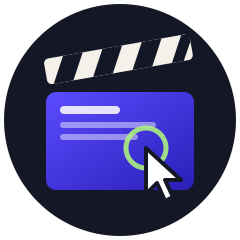

<p align="center">
  
</p>

<h1 align="center">screen-studio-director</h1>

<p align="center">
  An agent skill that lets a model record and edit product demo videos on a Mac with Screen Studio, with no hands on the mouse.
</p>

<p align="center">
  <a href="LICENSE"></a>
  <a href="https://agentskills.io/specification"></a>
  
  
  
</p>

## Quick start

You need a Mac with [Screen Studio](https://screen.studio) (installed and licensed), Google Chrome, [Homebrew](https://brew.sh) and Python 3.10+.

**1. Install the skill and its dependencies**

```sh
git clone https://github.com/LuminiteTime/screen-studio-director ~/.claude/skills/screen-studio-director
cd ~/.claude/skills/screen-studio-director
bash scripts/setup.sh
```

`setup.sh` installs ffmpeg, puts the Python packages into `.venv` inside the skill folder and checks everything. With the [skills CLI](https://skills.sh) the first line is `npx skills add LuminiteTime/screen-studio-director`; then `cd` into the folder it reports and run the same `setup.sh`.

**2. Allow control of the Mac**

System Settings > Privacy & Security: turn on your terminal app (Terminal, iTerm, Ghostty, VS Code...) under **Accessibility** and under **Screen Recording**, then quit and reopen the terminal.

**3. Check**

```sh
python3 scripts/doctor.py
```

```
ok      macOS
ok      python module pyobjc-framework-Quartz
MISSING ffmpeg
        fix: brew install ffmpeg
ok      Screen Studio app
MISSING Accessibility permission
        fix: System Settings > Privacy & Security > Accessibility: enable your terminal app, then restart it
2 missing
```

Run whatever `fix:` says, then run doctor again until it prints `all good`.

**4. Ask your agent**

> Record a 60-second demo of https://myapp.com: sign up, create a project, share it. English captions, light music, 16:9.

Hands off the mouse and keyboard while it records, and turn on Do Not Disturb. The agent runs doctor on its own before the first take and calls `setup.sh` if something is missing, so on a new Mac step 4 alone often works.

## Commands

All of them run from the skill folder. They are for checking and debugging; normally the agent runs them.

| Command | What it does |
|---|---|
| `python3 scripts/doctor.py` | checks the whole setup, prints a fix for each problem |
| `bash scripts/setup.sh` | installs or repairs dependencies, safe to re-run |
| `.venv/bin/python scripts/desktop.py` | screen size, cursor position, both permissions |
| `.venv/bin/python scripts/browser.py` | opens Chrome, moves the real cursor and checks the page sees it exactly there |
| `.venv/bin/python scripts/screen_studio.py` | lists Screen Studio's windows and every label the agent can click |
| `.venv/bin/python examples/take_web.py --dry` | rehearses the example scenario without recording |
| `.venv/bin/python examples/take_web.py` | records it with Screen Studio and exports to `examples/out/` |
| `.venv/bin/python scripts/assemble.py timeline.json --still 5` | renders one frame of the edit at 5 s as PNG |
| `.venv/bin/python scripts/assemble.py timeline.json` | renders the whole video |
| `.venv/bin/python scripts/music.py 60 bed.wav --mood calm` | 60 s of background music, moods `bright` `calm` `warm` `night` |

## Why

[Screen Studio](https://screen.studio) makes screen recordings look expensive. The cursor glides, the camera zooms in on clicks, and the window sits on a wallpaper with a soft shadow. It only works if a person is moving the mouse, though. Ask an agent to film your app and it will usually reach for Playwright, whose clicks happen inside the page and never move the system cursor. Screen Studio then records a frozen pointer and makes no zooms at all.

This skill gives the agent a real hand. It moves the macOS cursor with Quartz events, operates Screen Studio's own interface through accessibility, and drives your product from scripts. So a take can be rehearsed, recorded and reshot as many times as needed. Then it cuts the takes into a finished video with title cards, captions, a phone frame, crossfades and quiet background music.

Every rule in it comes from a real failed take. Clicks in the video were landing above their targets because CDP screencast frames are cropped on retina screens. One take stopped halfway when a click hit Screen Studio's floating widget. The saved area moved when the script dragged inside it. A Russian keyboard layout turned a file name into gibberish in the Save dialog.

## What a run looks like

You write something like *"Record a 60-second demo of our web app and the mobile version, captions in English, light music, 16:9, I'll post it on Product Hunt"*. The agent then:

1. turns the brief into beats, with one caption and one on-screen action per beat;
2. opens your app in a clean Chrome window and rehearses the whole scenario with recording off, screenshotting each step;
3. switches off the Screen Studio widgets that steal clicks, sets an exact recording area by numbers, starts the take and moves the real cursor through the scenario while logging timestamps;
4. stops, exports from Screen Studio and pulls stills to check that the cursor landed where it should;
5. tweaks the project if needed (zooms, speed-ups, background) by editing `project.json`;
6. cuts everything into one MP4 from a small timeline file and checks the frames before it hands the video over.

## What the skill makes the model do

It treats the brief as an acceptance test and checks the final video against it. It finds every button by text at run time instead of trusting remembered coordinates, and it never lets the first run of a scenario be the recorded one. Every pointer action in a take goes through the real cursor, while keyboard text can still go through the browser. It keeps the recorded area clear of the Dock, the picker and both Screen Studio widgets. Before cutting, it looks at stills from the take. Afterwards it puts back every preference it changed.

The edit stays quiet on purpose: soft crossfades, captions that glide in, music mixed around -24 dB. The product is the subject, and the motion design is there to serve it.

The rules live in [SKILL.md](SKILL.md). Details load only when the agent needs them, from [references/](references):

| File | Covers |
|---|---|
| [screen-studio.md](references/screen-studio.md) | the picker and its modes, menus, preferences, widgets, export, the `project.json` schema |
| [automation.md](references/automation.md) | real input, the Chrome rig, mapping page coordinates to the screen, finding elements, native apps |
| [devices.md](references/devices.md) | phone viewports, iOS Simulator, Android emulator, real devices, framing phone footage |
| [storytelling.md](references/storytelling.md) | brief to beats, pacing, caption copy, length per platform |
| [post-production.md](references/post-production.md) | timeline format, layouts, design directions, motion, music, encoding |
| [troubleshooting.md](references/troubleshooting.md) | symptom, cause and fix for everything that has broken so far |

## Inside

| Script | Does |
|---|---|
| `scripts/desktop.py` | real mouse, scroll and keys through Quartz, clipboard paste, screenshots in screen points |
| `scripts/screen_studio.py` | starts and stops takes in window, area or display mode, clicks Screen Studio UI by its labels, exports, closes the widget, edits projects |
| `scripts/browser.py` | a Chrome `--app` window through Playwright with exact page-to-screen mapping, Flutter web support, phone viewports and scenario marks |
| `scripts/assemble.py` | timeline JSON in, finished H.264 video out; `--still 12.5` renders one frame for a quick look |
| `scripts/music.py` | a synthesized ambient bed of any length in four moods, so there is no licensing question |
| `scripts/setup.sh`, `scripts/doctor.py` | one-time install, and a check that prints the fix for anything missing |

[examples/take_web.py](examples/take_web.py) records a short Wikipedia search, and [examples/timeline.json](examples/timeline.json) shows every timeline field.

## What was tested

Tested on Screen Studio 3.5.1 under macOS 26 with an English interface, on a 1512x982 MacBook screen. Web takes, phone-viewport takes, area and window recording, quick export, project export, `project.json` edits and the whole edit pipeline all ran end to end. The notes on iOS Simulator, the Android emulator and Screen Studio's Device mode for a cabled iPhone describe the approach but are marked as unverified. If your Screen Studio uses another interface language, run `.venv/bin/python scripts/screen_studio.py` to print the labels it actually shows.

This project is not affiliated with Screen Studio.

## License

[MIT](LICENSE)
